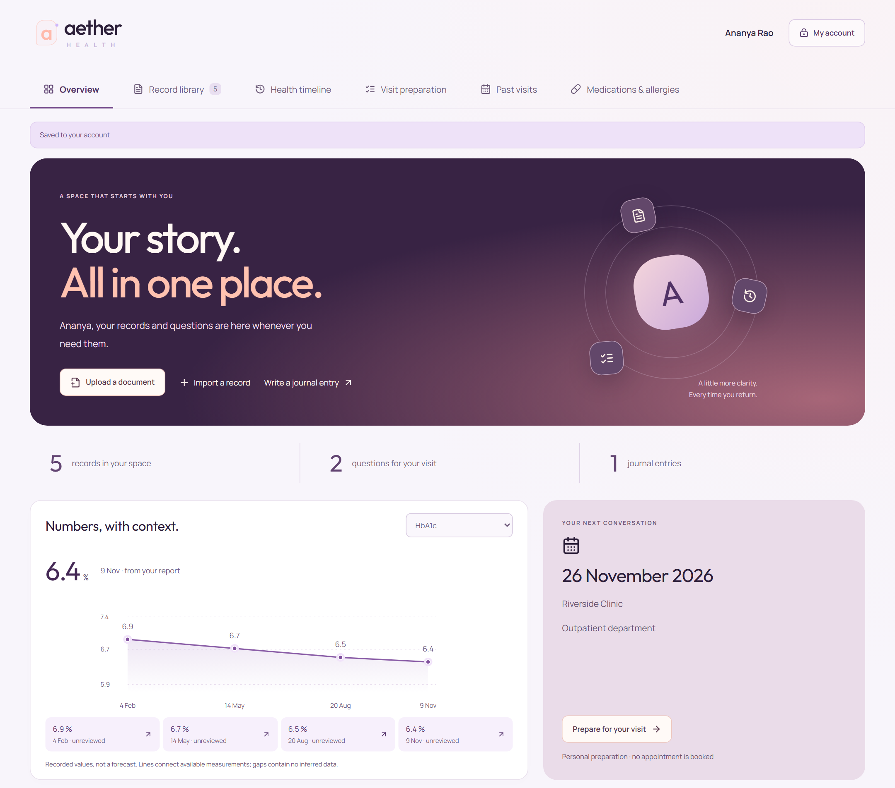
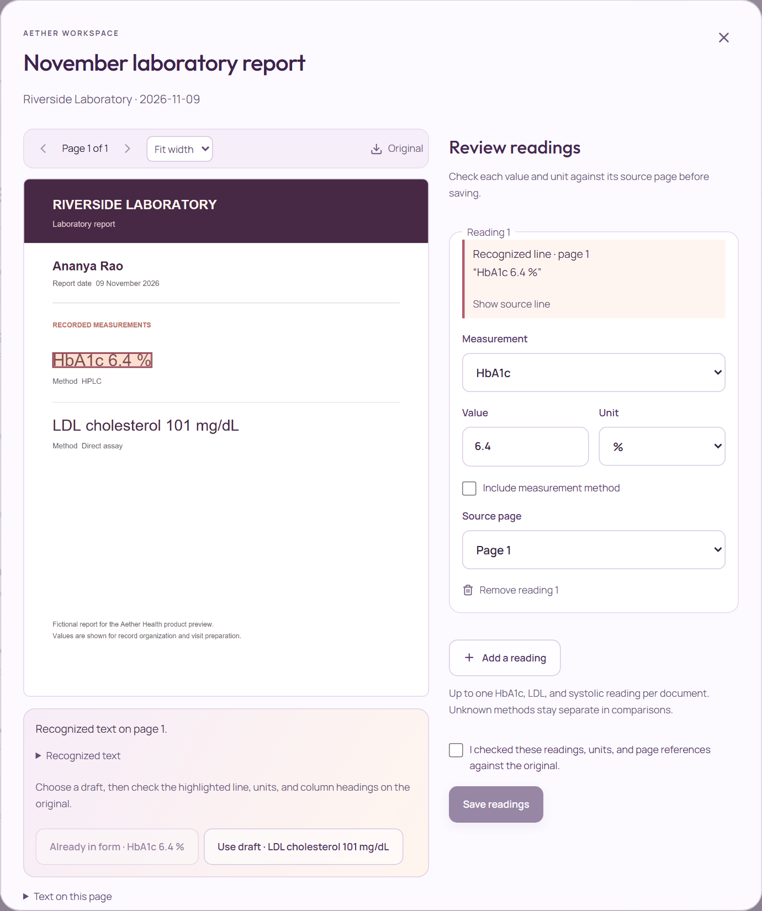
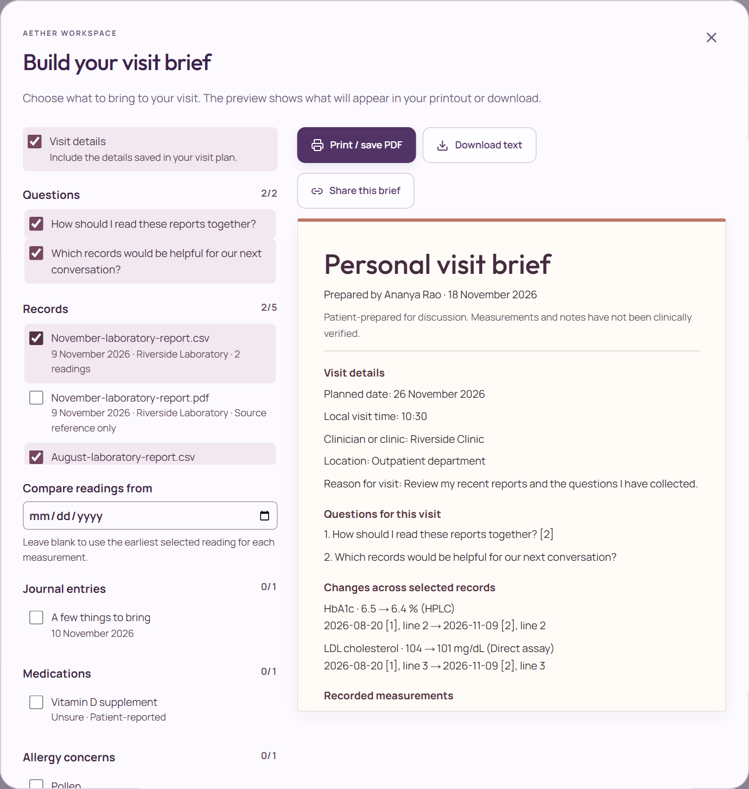
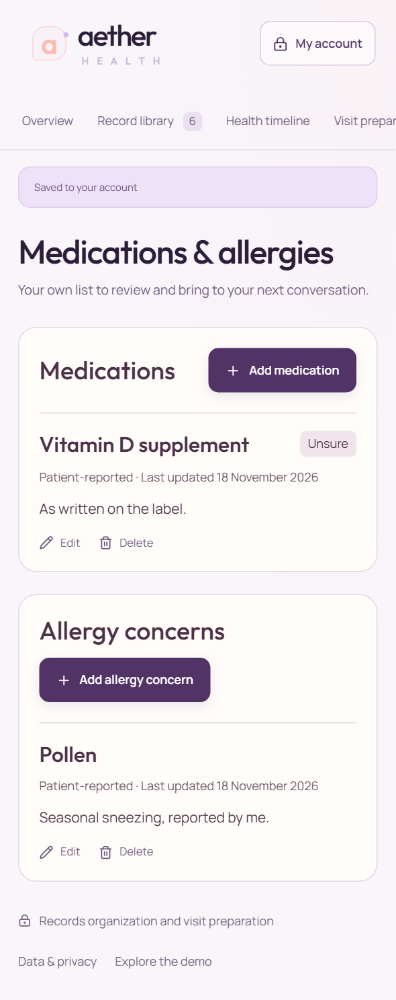

# Aether Health

A personal space for health records, the sources behind them, and the questions you want to bring to your next visit.



All screenshots show fictional records. Personal accounts begin with an empty workspace.

## Keep the source close

Upload a report, follow a measurement back to its page, and keep the original alongside your own notes.

- **Original documents** — PDF, PNG, and JPEG uploads with page viewing and unchanged original downloads.
- **Readings with context** — HbA1c, LDL cholesterol, and systolic blood pressure linked to the page or CSV line you reviewed.
- **On-device recognition** — read printed English from a scanned page, review an editable draft, and save it with the highlighted source.
- **A history you can follow** — search records, explore earlier snapshots, and compare readings with matching units and methods.
- **Your own health list** — patient-reported medications and allergy concerns with optional record links, alongside your journal.



## Bring a clearer picture to your visit

Save your visit plan and questions, then choose the records, health entries, and notes that belong in your brief. Preview the result before printing, saving a PDF, or downloading plain text.

Create a share link lasting one hour, 24 hours, or seven days. Each link opens a fixed copy of the selected brief. View or revoke active links from your account. Anyone holding a link can read and save its contents while access is available.



After an appointment, keep your account of what happened and the follow-up steps you want to take. Carry unanswered questions into the next visit and export selected dates to your calendar. Calendar entries cover whole days, with names, details, and a reminder request available as options.

<p align="center">
  
</p>

## Run locally

Use Node.js 24.

```sh
npm ci
npm run setup:local
npm run dev
```

Open [Aether at 127.0.0.1:3000](http://127.0.0.1:3000). Create your own space or explore the separate fictional demo at `/demo`.

Local setup creates private `.env.local` secrets and a SQLite database in `.data/`. Rerunning setup preserves existing data. Email verification is bypassed for loopback development. Password recovery requires SMTP configuration and the mail worker.

For a production build, run `npm run build`, then `npm run start`.

## Self-host

Docker Compose runs the web application, durable mail worker, Caddy HTTPS, and persistent database storage on one host.

```sh
npm run setup:deployment -- health.your-domain.com
# Add your SMTP settings to .env.production.
docker compose up --build -d
```

Provide a domain, host, and SMTP provider. Keep the database on persistent local storage and retain its data key separately. The deployment guide covers configuration, backups, recovery, and operating limits. [Self-hosting guide](deploy/README.md)

## Bring your records

Documents can be up to 5 MiB each. PDFs support up to 20 pages, and images support up to 20 megapixels. A workspace holds up to 100 records and 50 MiB of original files.

For CSV imports, use one report per file with matching date, provider, and author values.

```csv
date,provider,author,metric,value,unit,method
2026-10-27,Example Laboratory,Laboratory team,hba1c,6.7,%,HPLC
2026-10-27,Example Laboratory,Laboratory team,ldl,101,mg/dL,Direct assay
```

Include one HbA1c (`hba1c`) and/or one LDL (`ldl`) value with explicit units and methods. HbA1c accepts `%` or `mmol/mol`. LDL accepts `mg/dL` or `mmol/L`. Files must be UTF-8, at most 16 KB, and no more than 50 physical lines. Each imported reading retains its source line and file fingerprint.

Imported records and patient-entered information remain available for review with your clinician.

## Your data, your controls

Download workspace data, remove an individual record or health entry, erase the workspace, or delete the account. Download original PDFs and images from their viewers. Account exports include document metadata, fingerprints, and saved readings.

Workspace records, original files, and shared copies use server-side encryption. The operator holds the data key and can decrypt them. Account identity and action metadata remain readable to the operator. Recognition runs in the browser using assets served by the installation.

Deleting an included record, question, past visit, medication, or allergy concern revokes affected share links. Workspace erasure and account deletion disable all owned links. Recipients manage their saved copies, and operators manage backup retention. SQLite backups include original files and require the matching data key for recovery.

Aether supports records organization and preparation for conversations with a clinician. Publish the operator's identity, contact details, retention policy, and applicable terms before inviting people to a self-hosted installation.
